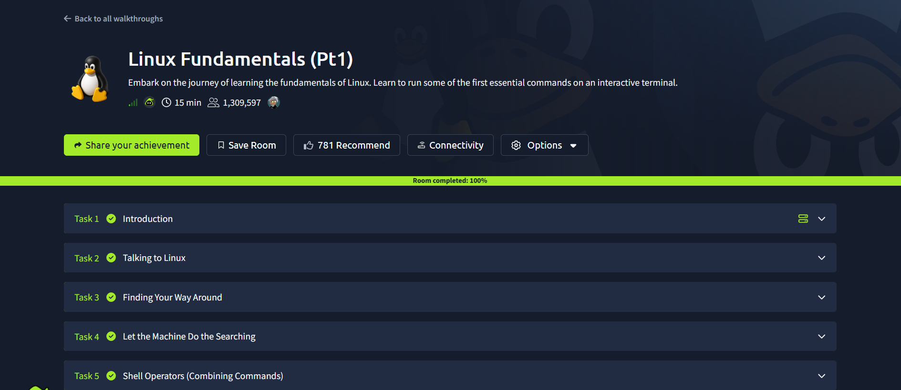
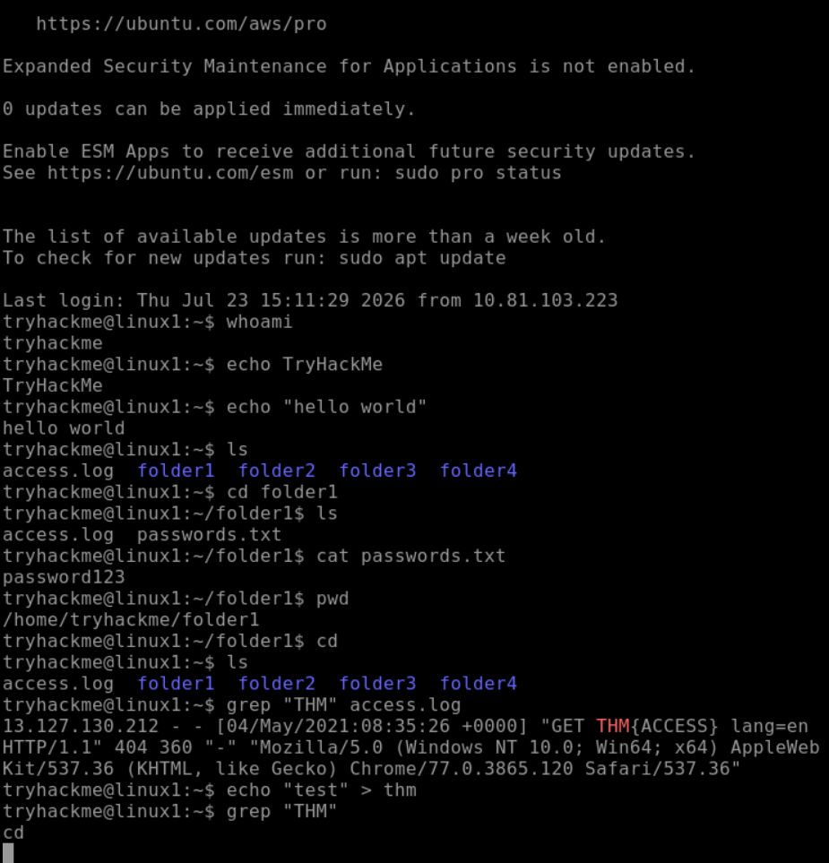

# 🐧🌲 TryHackMe — Linux Fundamentals Part 1

**Platform:** TryHackMe  
**Room:** Linux Fundamentals Part 1  
**Status:** ✅ Completed  
**Category:** Linux Fundamentals | Cybersecurity Foundations

---

## 🍃 About This Room

My first completed TryHackMe room!

I'm using TryHackMe to build my hands-on cybersecurity skills, and Linux Fundamentals Part 1 was a great place to start.

I enjoy figuring out how systems work, so getting more comfortable navigating Linux through the command line is an important part of my learning journey.

## 🛠️ Linux Skills & Commands

This room introduces foundational Linux concepts and commands such as:

| Command | Purpose |
|---|---|
| `pwd` | Shows your current working directory |
| `ls` | Lists files and directories |
| `cd` | Changes directories |
| `cat` | Displays file contents |
| `find` | Searches for files |
| `grep` | Searches text for matching patterns |

These are examples of topics covered by the room, not a record of every command I personally ran.

## 🔐 Why This Matters for Cybersecurity

Linux is widely used in servers, security tools, and cybersecurity environments.

Understanding the command line helps me build the foundation for investigating suspicious activity, navigating system files, reviewing logs, and troubleshooting security issues.

## 🌱 My Key Takeaways

This room helped me strengthen my understanding of Linux fundamentals and continue building confidence working with the command line.

As I complete more TryHackMe rooms, I plan to document the commands I use, the problems I solve, and how each exercise connects to real-world security operations.

## 📸 Lab Evidence

*Screenshots of my completed exercises and command-line practice will be added here.*

### 🌿 TryHackMe Room Completion

### 🐧 Linux Command Practice

---
